<div align="center">

# dawg_welding

### Autonomous force-controlled surface work with a legged mobile manipulator

**Unitree Go2 quadruped + Unitree Z1 arm in MuJoCo.** It finds a job from an ArUco marker, walks there (including up stairs), measures a surface it has never seen, and presses a tool on it at **5 N** along the surface normal.

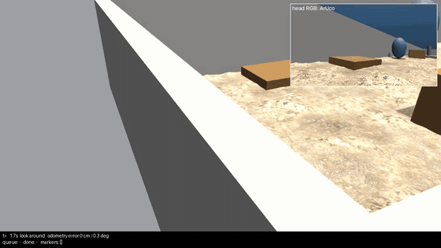

<sub>Full mission (seed 3) at 14× speed: 4 markers found, 4 surfaces worked, 705 s of simulated time, 46 m walked.</sub>

[📄 Report (PDF)](docs/report/dawg_welding_report.pdf) · [📊 Slides (PDF)](docs/presentation/slides.pdf) · [🗒 Slide notes](docs/presentation/slide_explanations.md) · [🔧 Technical notes](docs/TECHNICAL_NOTES.md) · [📓 Project log](docs/PROJECT_LOG.md)

</div>

---

## Results at a glance

| | |
|---|---|
| **Mission success** | **4 / 4 surfaces in all 6 runs** (3 noise seeds × 2 strategies) |
| **Coverage** of each requested work area | **91–100 %** |
| **Force** within 5 N ± 20 % | **87–100 %** of contact time, **contact never lost** |
| **Localisation** (odometry + depth-to-map matching) | **0.8–1.8 cm** mean error, heading within 1.7° |
| **Surface model** vs ground truth | 0.1–0.2 mm depth, 0.6–1.0° normal (RMS) |
| **Stance WBC** while the arm works | body moves **0.4 mm**, tool tracks to **0.08 mm** |
| **Walking with the arm** (PPO fine-tune) | falls 3/30 → **0/30**, body tilt 18° → **5°** |

<p align="center">
  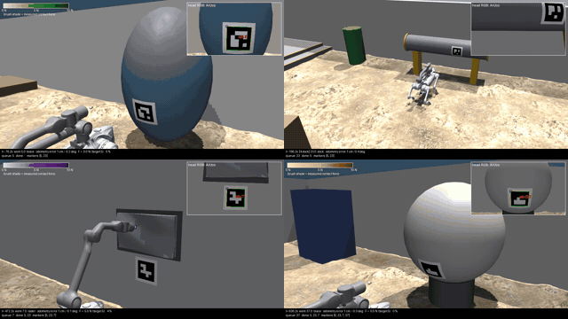<br/>
  <sub>The same six-step job pipeline on four different surfaces. The colour painted on the surface is the measured contact force.</sub>
</p>

---

## The task

A work order says *"cover a W × H area next to marker k with 5 N along the surface normal"*.

| the robot is given | the robot does **not** know |
|---|---|
| a 2-D floor map (walls and obstacles) | where the markers are |
| the work order (marker id, area size) | which object carries a marker |
| its own drifting odometry | the exact shape of any surface |

The four test surfaces are picked so that no single shape assumption works for all of them: a **vessel** (large ellipsoid), a horizontal **pipe** (curved in one direction), a random **wavy panel** (freeform, ±3 cm, slopes up to 30°) and a spherical **tank** (curved in two directions).

<p align="center">
  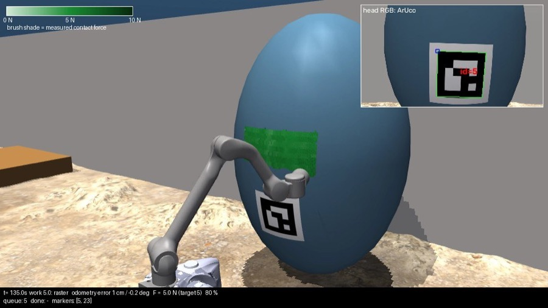
  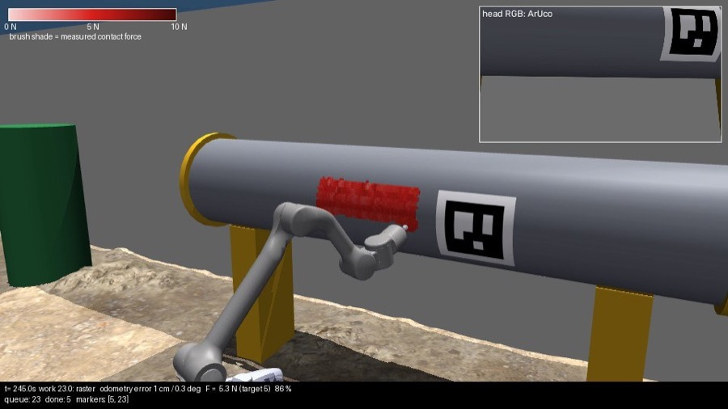
  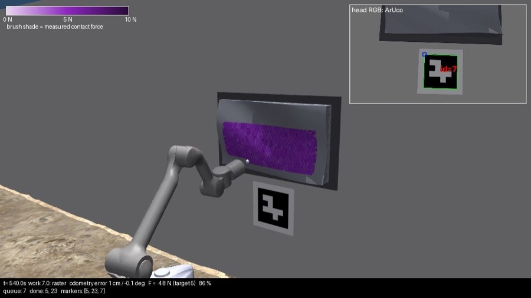
  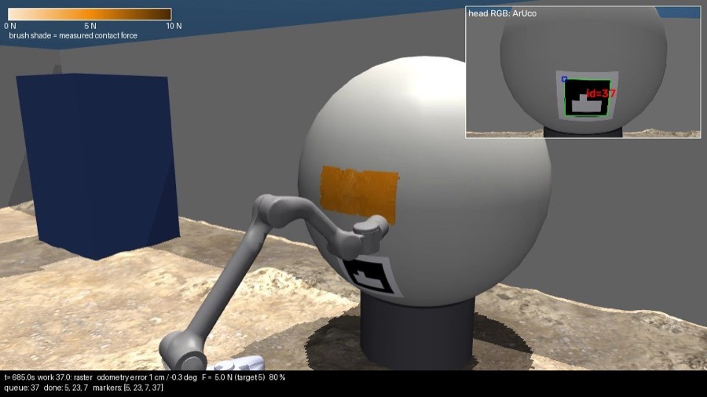
</p>

---

## How the robot thinks: five layers, one job pipeline

Each layer answers one question and trusts the layers below it.

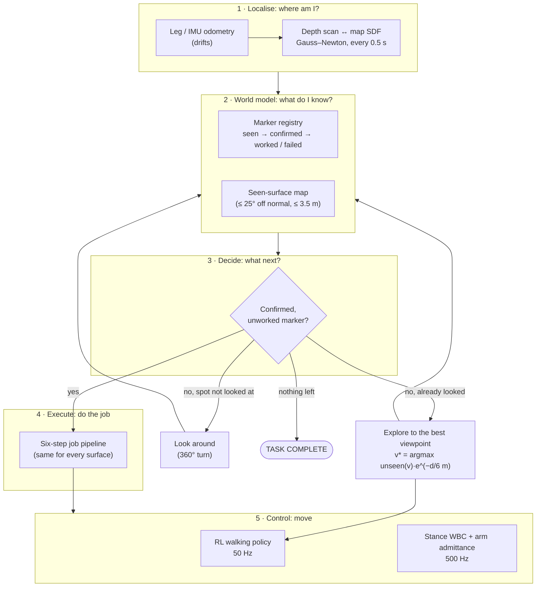

### The six steps (identical for every surface)

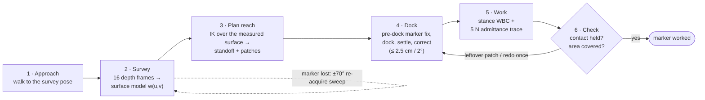

### Control hand-off

Walking and standing work use different controllers. They never run at the same time.

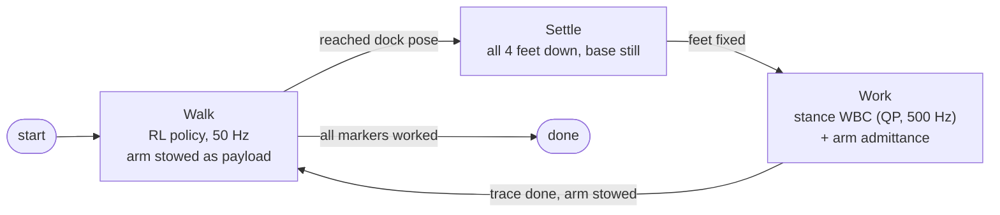

---

## Components

### 1. Walking with ~30 % extra mass

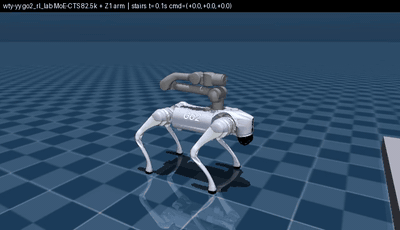

- **Policy:** π(oₜ) → aₜ at 50 Hz, joint target q\* = q₀ + 0.25 aₜ tracked by joint PD.
- **Stairs:** the blind **MoE-CTS** policy (mixture of experts, concurrent teacher–student), used zero-shot. It climbs the 10 cm stairs with the arm on board.
- **Flat-ground fine-tune with the arm:** PPO in MuJoCo, warm-started actor + critic, arm-mass curriculum ×0.6 → ×1.25, randomised base mass, friction and pushes. 6.5 M samples, **24 min on a laptop CPU**.
- **Result:** falls 3/30 → 0/30, tilt 18° → 5°, sideways tracking 81 → 94 %.

<br clear="right"/>

<p align="center">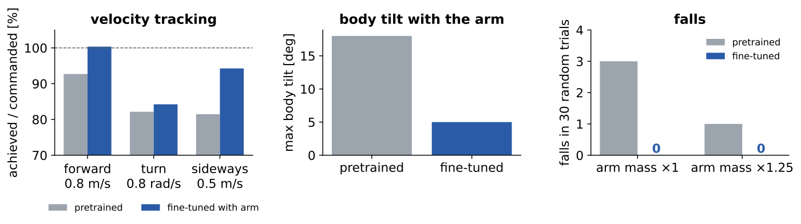</p>

### 2. Holding still while the arm works: the stance WBC

One quadratic program picks every joint torque (legs + arm) every 2 ms. The DAQP solver takes ≈ 0.2 ms per solve.

$$\min_{\ddot q,\,f}\ \sum_i w_i\big\|J_i\ddot q + \dot J_i\dot q - a_i^\ast\big\|^2 \quad\text{s.t.}\quad
\begin{cases}
M_b\ddot q + h_b = J_{c,b}^\top f & \text{floating base}\\
J_c\ddot q + \dot J_c\dot q = -k_c J_c\dot q & \text{feet fixed}\\
|f_{x,y}| \le \mu f_z,\ f_z \ge 5\,\text{N} & \text{friction cone, } \mu = 0.6\\
|\tau| \le \tau_{\max} & \text{torque limits}
\end{cases}$$

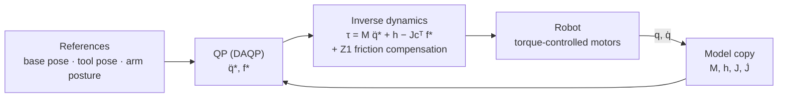

<p align="center">
  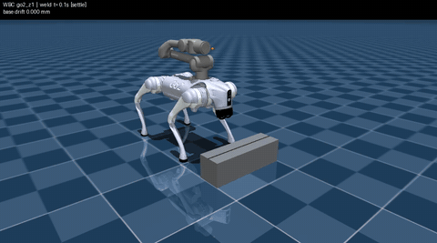
  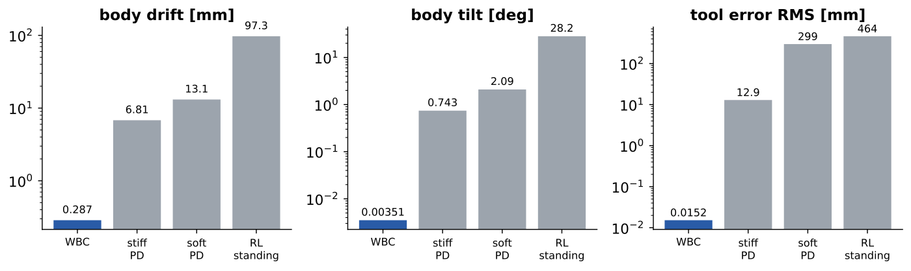
</p>

Against the best baseline (stiff joint PD) the WBC has **24× less body drift and 850× less tool error**. The ablation below removes one design choice at a time:

<p align="center">
  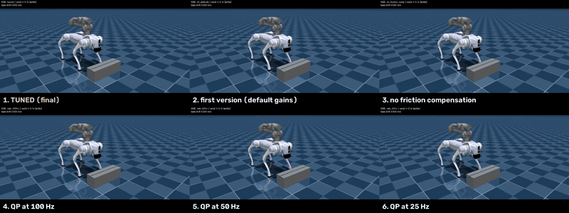
  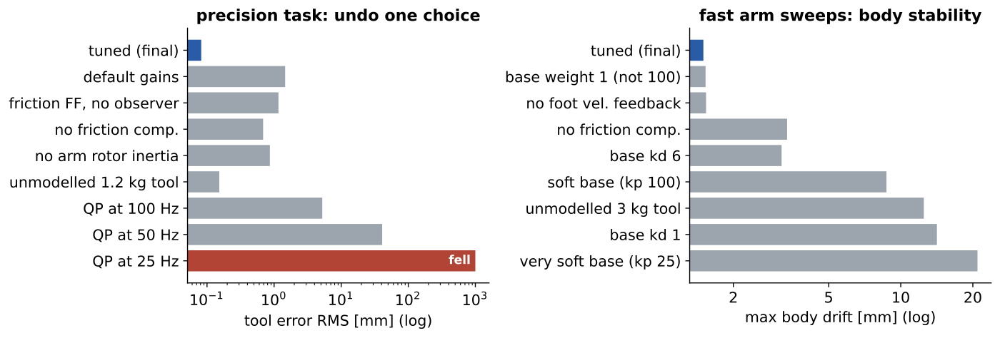
</p>

**Takeaway:** control rate matters more than tuning. At 500 Hz the controller works; at 25 Hz the robot falls. An unmodelled 1.2 kg tool costs only 0.15 mm.

### 3. Pressing just right: admittance force control

The robot doesn't command a force directly. It places the tool target slightly *inside* the surface and adjusts how deep until the sensor reads 5 N:

$$\dot\delta = k_a\,(F^\ast - F), \qquad p_{\text{tool}} = p_{\text{surf}}(u,v) - \delta\,n$$

<p align="center">
  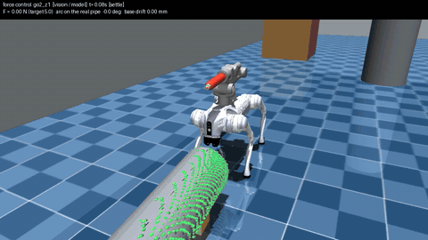
  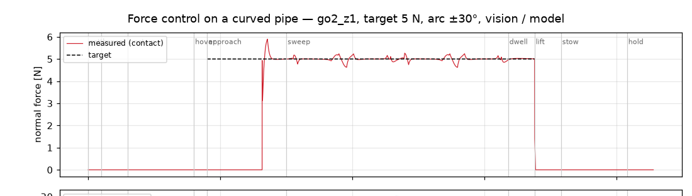
</p>

On the pipe: mean **5.00 N**, 0.10 N RMS error, contact never lost, tool **0.34°** from the true normal. A measured negative result: the force feed-forward made no difference (5.01 N mean with the desired force, with the measured force, and with none). The admittance loop does the work.

### 4. From depth points to a surface model to a reach plan

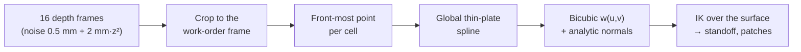

<p align="center">
  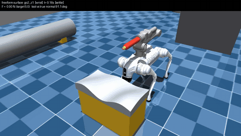
  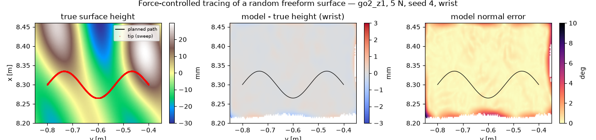
</p>

The reach plan picks the standoff from the reachable-width curve rather than a fixed number. Raising the pipe from 0.55 m to 0.66 m turned a single narrow spike into a wide plateau that tolerates docking errors (coverage went from 68 % to 99–100 %).

<p align="center">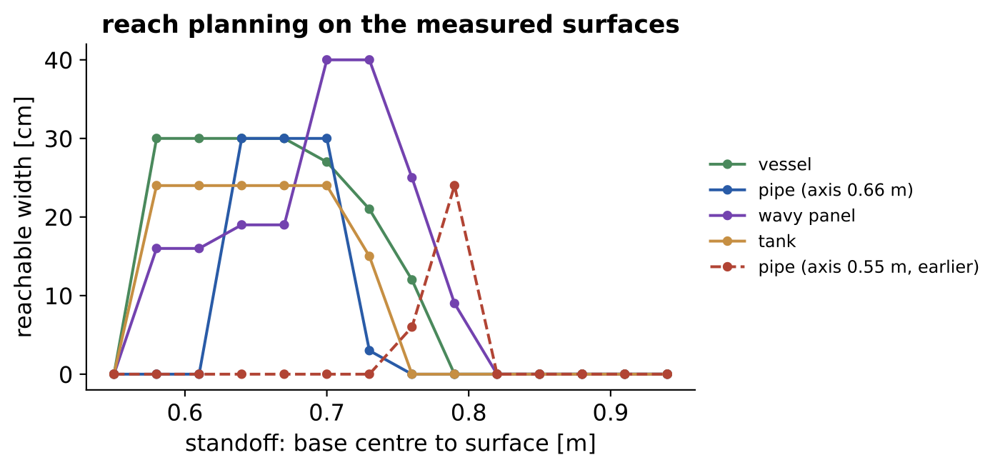</p>

### 5. Where am I, and where to look next?

**Localise:** the depth scan is matched to the map's signed-distance field.

$$\min_{\Delta x,\Delta y,\Delta\theta}\ \sum_k \rho\big(\mathrm{SD}(R_{\Delta\theta}\,p_k + t)\big)$$

- ρ is a Huber cost, so unmapped clutter can't drag the solution.
- Only well-observed directions (large eigenvalues of JᵀJ) are corrected. In a featureless corridor the robot keeps odometry along the corridor.
- Partial-height objects (pipe on saddles, tanks on pedestals, the wall panel) are left out of the matching map. Before this the localiser drifted 26 cm / 7.5°.

**Explore:** v\* = argmax unseen(v) · e^(−d(v)/6 m). A\* runs on a 5 cm occupancy grid, with the stairs as a portal edge.

<p align="center">
  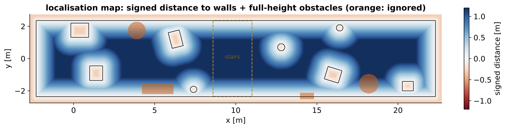
  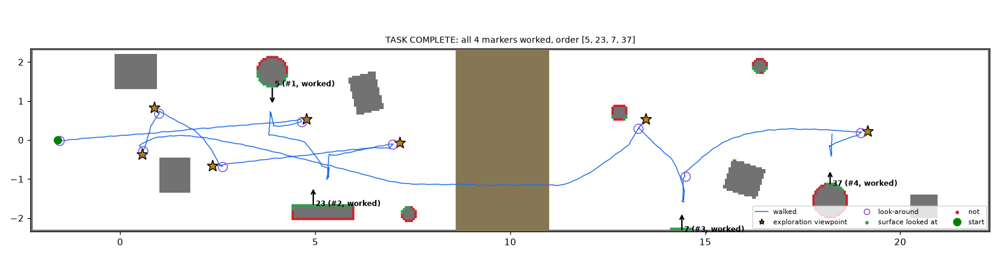
</p>

---

## Full mission results

| | seed 1 | seed 2 | seed 3 | map-first |
|---|---|---|---|---|
| result | ✅ COMPLETE | ✅ COMPLETE | ✅ COMPLETE | ✅ COMPLETE |
| order worked | 5 → 23 → 7 → 37 | same | same | 37 → 7 → 23 → 5 |
| time / distance | 696 s / 46 m | 731 s / 46 m | 705 s / 46 m | 775 s / 59 m |
| coverage (5 / 23 / 7 / 37) | 100 / 97 / 100 / 100 % | 100 / 100 / 91 / 100 % | 100 / 99 / 100 / 100 % | 100 / 98 / 100 / 100 % |
| within 5 N ± 20 % | 87–100 % | 93–100 % | 93–100 % | 92–100 % |
| contact lost | 0 % | 0 % | 0 % | 0 % |
| localisation error (mean) | 1.0 cm | 0.8 cm | 0.8 cm | 1.8 cm |

<p align="center">
  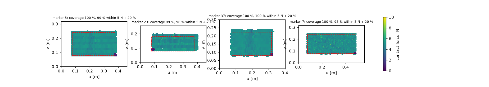
  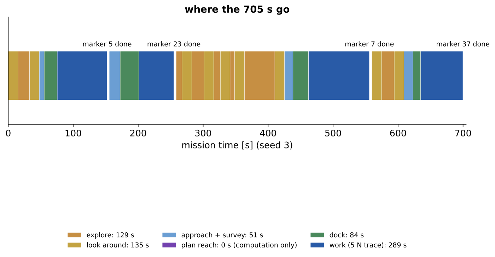
</p>

41 % of mission time is spent tracing (useful work) and 37 % searching (explore + look around). Searching is the main cost to cut.

---

## Quick start

```bash
conda create -n spot_weld python=3.11 && conda activate spot_weld
pip install -r requirements.txt
bash scripts/setup_assets.sh            # MuJoCo Menagerie robots -> third_party/

# headline mission: find 4 markers on curved surfaces and work each at 5 N
python sim/curved_mission.py --no-video --seed 3 --tag _seed3           # stats only (~10 min)
python sim/curved_mission.py --seed 3 --tag _seed3_video                # with video (~30 min)
python sim/curved_mission.py --no-video --strategy map_first --tag _mf  # explore first, then work

# individual components
python sim/stance_demo.py --robot go2_z1      # stance WBC: weld + stress scenarios
python sim/force_demo.py                      # 5 N sweep over a pipe measured by the depth camera
python sim/surface_demo.py --panel-seed 4     # wrist scan + trace of a random freeform panel
python sim/mission_demo.py                    # plan → walk → scan → dock → force task → walk home
python sim/aruco_mission.py                   # find and visit 4 ArUco markers (no contact)
python sim/locomotion/train_payload.py        # PPO fine-tune of the Go2 policy with the arm (~24 min CPU)
mjpython sim/stance_demo.py --viewer          # live viewer (macOS needs mjpython)
```

Runs are deterministic for a given `--seed`. Outputs go to `results/<experiment>/`.

---

## Repository layout

```
sim/
├── curved_mission.py, curved_world.py   headline mission: 5-layer flow, terrain corridor with 4 surfaces
├── wbc/                                 robot configs + model builder, stance WBC (QP)
├── locomotion/                          RL policies in MuJoCo, PPO payload fine-tune, evaluation
├── perception/                          depth/RGB cameras, ArUco, cylinder fit, surface fit, map localiser
├── planning/                            occupancy grid + A*, path follower, marker registry, explorer
├── force_task.py, surface_task.py       force-controlled tracing (pipe, freeform surface)
├── *_demo.py                            stand-alone demos for each component
└── markers.py, paint.py, stance_hold.py ArUco meshes, coverage painting, stance references
policies/go2/                            walking policies: go2_z1_payload (fine-tuned), moe_cts_82.5k, symmetry_77k
description/                             Go2 + Z1 URDF and builder
assets/                                  scene meshes and textures
results/                                 metrics (JSON), plots and videos per experiment
docs/                                    report, slides, technical notes, project log, README media
archive/                                 earlier Spot and ANYmal-C prototypes (see archive/README.md)
scripts/                                 asset setup and scene conversion
```

---

## Limitations and next steps

- **Simulation only.** The WBC reads the true state (no estimator), and the force sensor is ideal.
- **The tool** is a frictionless 8 mm ball: contact force is modelled, material removal is not.
- **No reaction to unmapped obstacles.** The depth camera is used for localisation and surveys, not obstacle detection.
- **Pipe docking is 5–10 cm off,** likely from marker-pose bias on a curved sticker. The wide reach window absorbs it.
- **The walking policy was not fine-tuned with the arm on stairs.**

**Next:** local obstacle avoidance, a real grinding / inspection tool with a process model, stairs fine-tuning with the arm, and a state estimator plus a real F/T sensor for hardware.

## Credits

Built on pretrained Go2 walking policies (MoE-CTS), [MuJoCo Menagerie](https://github.com/google-deepmind/mujoco_menagerie) robot models, and a teammate's ArUco exploration mission.
